<div align="center">


# Astrolabe Studio

**Один десктопний застосунок, щоб запускати, відстежувати й керувати багатьма локальними сесіями Claude Code.**

Візуальне рев'ю того, що будує Claude (скріншоти й живі сайти), команди агентів, сповіщення та підтвердження всього, про що просить Claude, в один клік.

[](https://github.com/krpkbhdn/astrolabe-studio/releases)

-orange)


[](https://ko-fi.com/krpkbhdn)

[English](README.md) · **Українська**

</div>

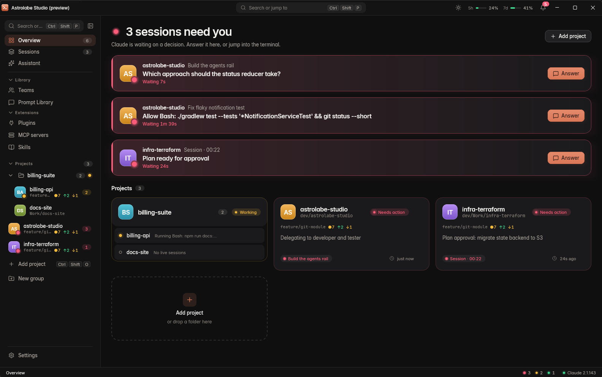

**Зміст:** [Навіщо](#навіщо) · [Візуальне рев'ю](#візуальне-ревю) · [Веб-рев'ю](#веб-ревю) · [Швидкий старт](#швидкий-старт) · [Можливості](#можливості) · [Скріншоти](#скріншоти) · [Вимоги](#вимоги) · [Встановлення](#встановлення) · [Збірка і запуск із коду](#збірка-і-запуск-із-коду) · [Збірка інсталяторів](#збірка-інсталяторів) · [Гарячі клавіші](#гарячі-клавіші) · [Конфігурація](#конфігурація) · [Підтримати](#підтримати-проєкт) · [Ліцензія](#ліцензія)

## Навіщо

Коли працюєш із кількома сесіями Claude Code, маєш купу терміналів і не знаєш, у якому з них на тебе чекають.
Astrolabe Studio збирає їх в одному вікні: кожна сесія показує свій стан, а кожне запитання, план чи запит на дозвіл
стає діалогом, на який можна відповісти, не шукаючи потрібний термінал.

Те, чого немає в жодному іншому інструменті для Claude Code, це **візуальне рев'ю**: коли Claude змінює інтерфейс, ви позначаєте проблеми на його скріншотах і одразу надсилаєте позначки назад.

Усе працює **локально, на вашій власній установці Claude Code**. Серверної частини немає, ваші сесії ніхто не проксіює.

## Візуальне рев'ю

Claude змінює інтерфейс, робить скріншоти й передає їх вам. Ви обводите, що не так, пишете коментар до кожної позначки,
і анотовані зображення повертаються в сесію. Більше не треба словами пояснювати «третя кнопка зліва».

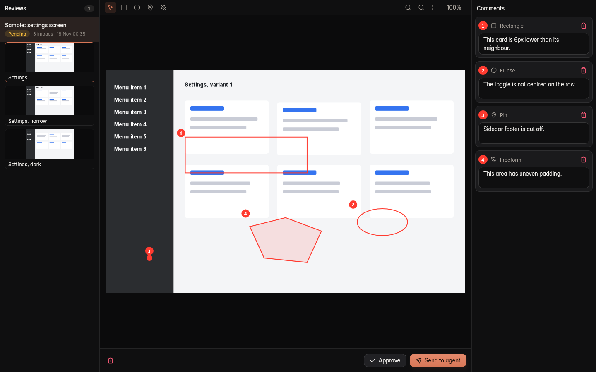

<details>
<summary>Світла тема</summary>

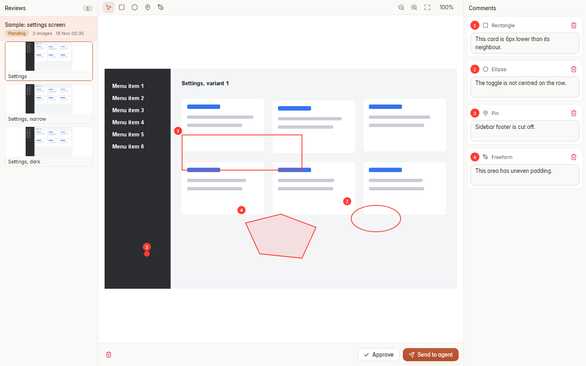

</details>

**Як це працює**

1. Claude викликає MCP-інструмент `submit_screenshots` зі зробленими зображеннями. Перший виклик запитує ваш дозвіл, бо застосунок копіює вказані файли.
2. Вкладка **Review** (`Ctrl+Shift+Z`) показує їх, а бейдж рахує рев'ю, що чекають на вас. Сама вона ніколи не відкривається.
3. Ви позначаєте проблеми інструментами **Rectangle**, **Ellipse**, **Pin** або **Freeform** (багатокутник, що ставиться точка за точкою й замикається кліком на першій точці). Позначки можна переміщати, змінювати за 8 ручками, а вершини багатокутника перетягувати. Позначки нумеруються на кожному зображенні, до кожної є власний коментар.
4. **Send** передає анотовані зображення разом із `review.md` з усіма коментарями у прив'язану або обрану сесію через її чергу промптів чи запускає нову. **Approve** закриває рев'ю.

Рев'ю старші за 7 днів видаляються автоматично (`astrolabe.review.retention`).

Бонус: вбудований skill плагіна `visual-review` навчає Claude самому робити й надсилати скріншоти.

## Веб-рев'ю

Claude будує вебсайт, а ви переглядаєте саму запущену сторінку, не лише скріншоти. Вкладка **Web** (`Alt+F11`) вбудовує Chromium (JCEF): ви клікаєте по справжній сторінці й точно кажете Claude, що змінити.

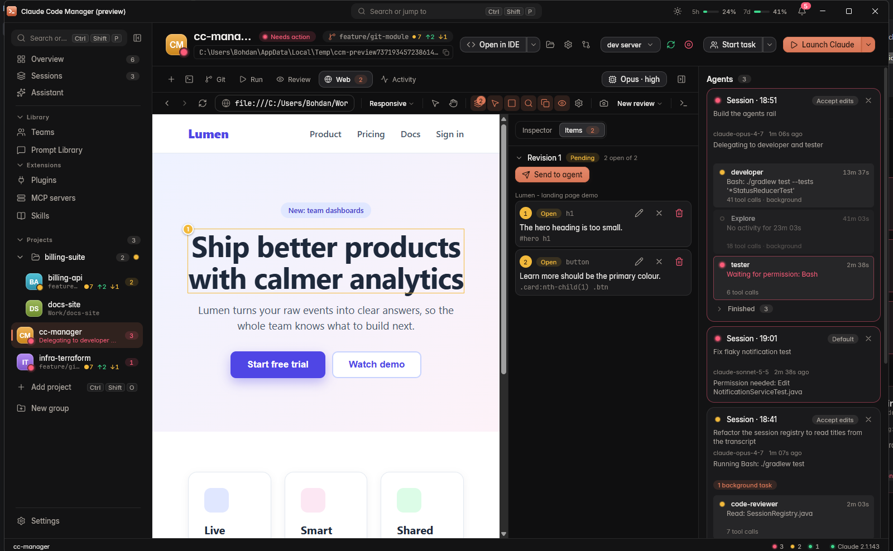

- **Вибір елементів** (`I`) і коментар: пронумерований пін прив'язується до елемента (селектор, XPath, обчислені стилі, підказка про джерело).
- **Живе редагування стилів** в інспекторі з миттєвим результатом; зміни потрапляють у відгук.
- **Режим пристрою**: пресети mobile, tablet і desktop або власний розмір, обертання та масштаб до 400%; відгуки розділяються за категорією пристрою.
- **Оверлеї**: відступи, аудит, схожі елементи й контраст, а також стек шарів під курсором (права кнопка миші).
- **Скріншоти в Review**: видима частина, вся сторінка або виділена область потрапляють на вкладку Review (`S`, `Shift+S`, `R`).
- **Send** надсилає відкриті пункти у прив'язану або обрану сесію як промпт (через її чергу) чи запускає нову; **Approve** закриває ревізію.

Вкладці Web потрібен JCEF-варіант JetBrains Runtime (`jbrsdk_jcef`); збірка це перевіряє, а без нього вкладка пояснює, чого бракує.

**Review чи Web?** [Візуальне рев'ю](#візуальне-ревю) для зображень, які зробив Claude (скріншоти, макети); веб-рев'ю для сторінки, що запущена просто зараз.

## Швидкий старт

1. Встановіть [Claude Code](https://code.claude.com/docs/en/overview) і увійдіть в акаунт.
2. Встановіть Astrolabe Studio зі сторінки [Releases](https://github.com/krpkbhdn/astrolabe-studio/releases) (`.msi`, `.deb`, `.rpm`, `.tar.gz`, `.dmg`; див. [Встановлення](#встановлення)) або [зберіть із коду](#збірка-і-запуск-із-коду).
3. Запустіть застосунок, натисніть `Ctrl+Shift+O`, щоб додати теку проєкту, потім `Ctrl+Shift+T`, щоб запустити в ній сесію Claude.

Коли сесії потрібна ваша увага, вона червоніє в «Огляді» та в рядку стану; `Ctrl+Shift+N` відповідає на наступну.

## Можливості

**Візуальне рев'ю**
- **[Веб-рев'ю](#веб-ревю)**: вкладка з вбудованим Chromium для запущеного сайту: вибір елементів, піни з коментарями, живе редагування стилів, пресети пристроїв, оверлеї аудиту й відступів, скріншоти в Review, відгук у сесію як промпт.
- **[Візуальне рев'ю](#візуальне-ревю)**: Claude надсилає скріншоти, ви позначаєте проблемні місця (прямокутник, еліпс, пін, довільний багатокутник) з пронумерованими коментарями на вкладці Review, а потім надсилаєте анотовані зображення та `review.md` у сесію або затверджуєте.

**Сесії**
- **Проєкти й сесії**: реєструйте теки проєктів, запускайте або відновлюйте сесії Claude у справжньому вбудованому терміналі.
- **Стан наживо**: кожна сесія *очікує*, *працює* або *потребує дії*; рядок стану, сповіщення та дошка «Усі сесії» показують це одразу.
- **Відповідь із застосунку**: запитання, затвердження плану, дозволи на інструменти та MCP-форми відкриваються модальними діалогами. Діалог у терміналі залишається живим, виграє той, хто відповів першим.
- **Звичайні оболонки**: PowerShell, cmd, Git Bash і WSL у Windows, ваш `$SHELL` деінде, окремою вкладкою поруч із Claude.

**Агенти й автоматизація**
- **Команди агентів**: описуйте ролі (модель, рівень міркування (effort), інструменти) і запускайте лідера, що делегує нативним субагентам.
- **Асистент**: сесія Claude поза проєктами, яка відкриває проєкти, запускає сесії й керує застосунком через окремий MCP-сервер.
- **Бібліотека промптів і черга**: шаблони з плейсхолдерами та черга на сесію, що набирає наступний промпт, коли завершується хід.
- **Конфігурації запуску**: запускайте свій застосунок із менеджера; Claude може зареєструвати конфігурацію для власного git worktree.

**Робоче середовище**
- **Вкладка Git**: зміни з diff за фрагментами (hunk), коміт, граф журналу, гілки, stash і теги.
- **Лічильники використання**: ліміти 5 годин і 7 днів (лише для планів Pro/Max; плани Team натомість показують список за сесіями), а також модель, контекст і вартість кожної сесії.
- **Розширення**: керування плагінами, маркетплейсами, MCP-серверами та skills.
- **Голосовий ввід** (експериментальний, спершу Windows): утримуйте пробіл у полях промпту, завдання й повідомлення коміту, щоб диктувати локальною моделлю Whisper. Моделі завантажуються лише за вашою командою.
- **Мовні сервери (LSP)**: швидке налаштування для проєкту. Застосунок визначає мови у вашій теці, ставить сервер (jdtls і kotlin-lsp завантажуються автоматично з перевіркою контрольної суми) і вмикає LSP-плагін Claude одним перемикачем у Налаштуваннях проєкту → Languages. Підтримуються: TypeScript/JavaScript (разом з React), CSS/SCSS/Less, C/C++, Java, Python, Rust, Go, C# і Kotlin.
- **Code Mode для MCP**: ховає обрані MCP-сервери проєкту від Claude, а він знаходить інструменти пошуком і викликає їх коротким JavaScript-скриптом, тож довгі списки інструментів більше не забивають контекст. Вмикається для проєкту в Налаштуваннях проєкту → Code Mode або через пресет проєкту. Рівні ізоляції: **пісочниця GraalJS** всередині застосунку (за замовчуванням, без додаткового ПЗ) або **контейнер Docker/Podman** (найсильніша межа, вибирається в Налаштуваннях → Code Mode). Виклики інструментів лише для читання виконуються самі, решта спершу питає вас.
- **Палітра команд і гарячі клавіші** майже для всього.

## Скріншоти

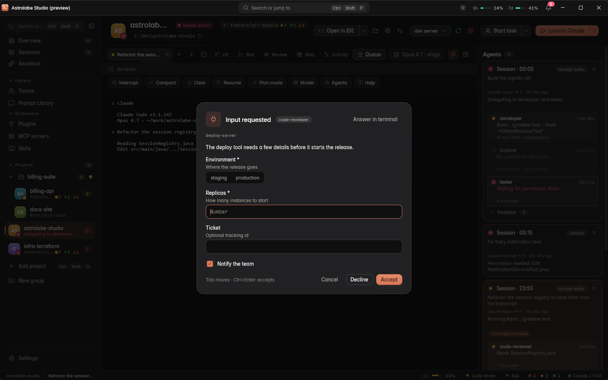
*Запитання, плани й дозволи відкриваються діалогами, шукати термінал не треба.*

| | |
|---|---|
| 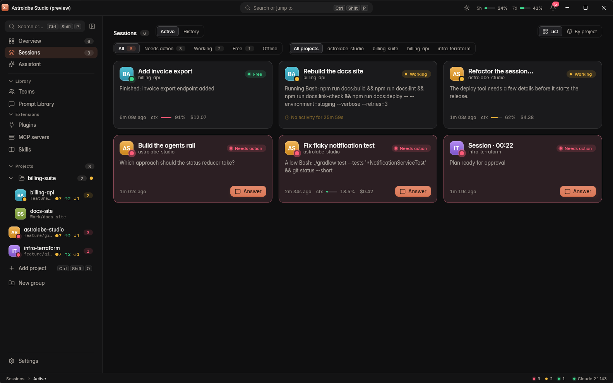<br/>**Усі сесії** | 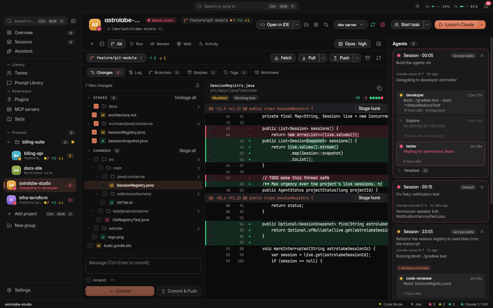<br/>**Git: зміни** |
| 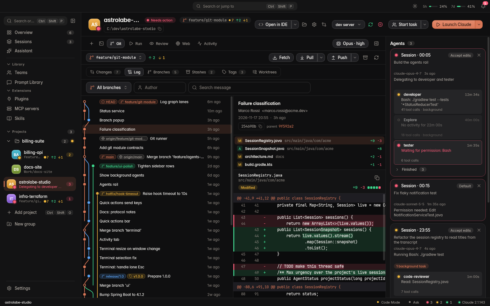<br/>**Git: журнал** | 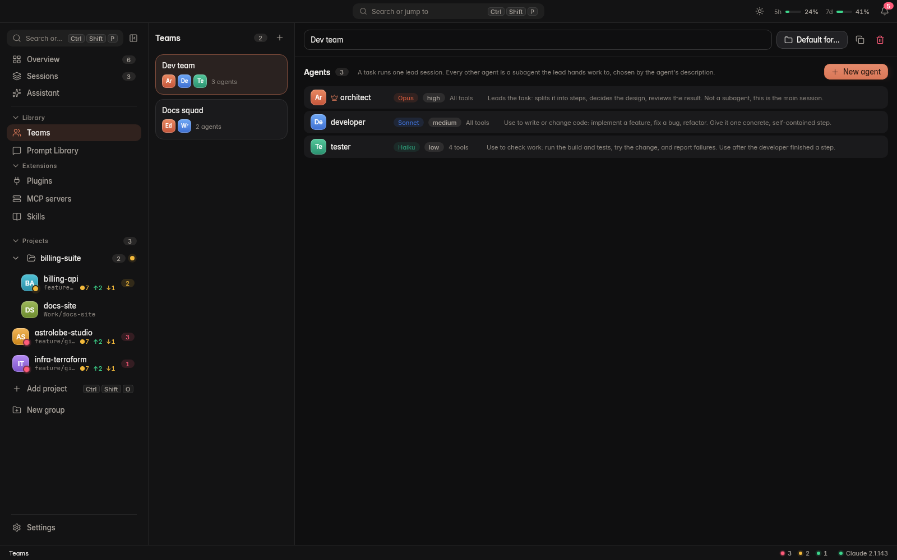<br/>**Команди агентів** |
| 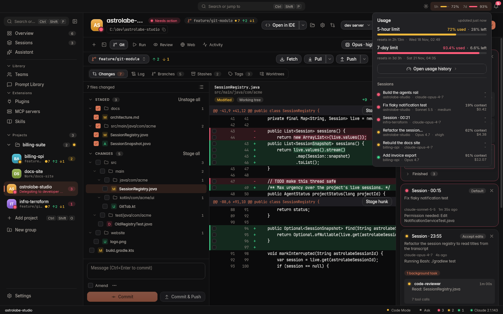<br/>**Використання** | 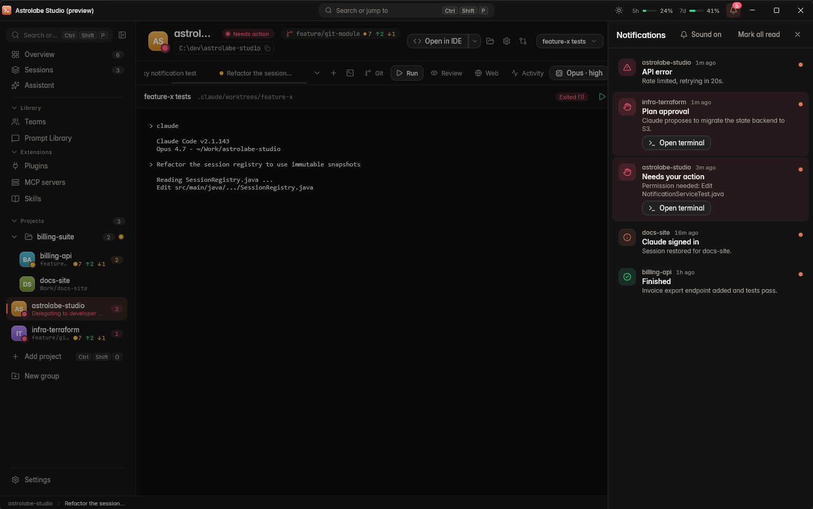<br/>**Сповіщення** |
| 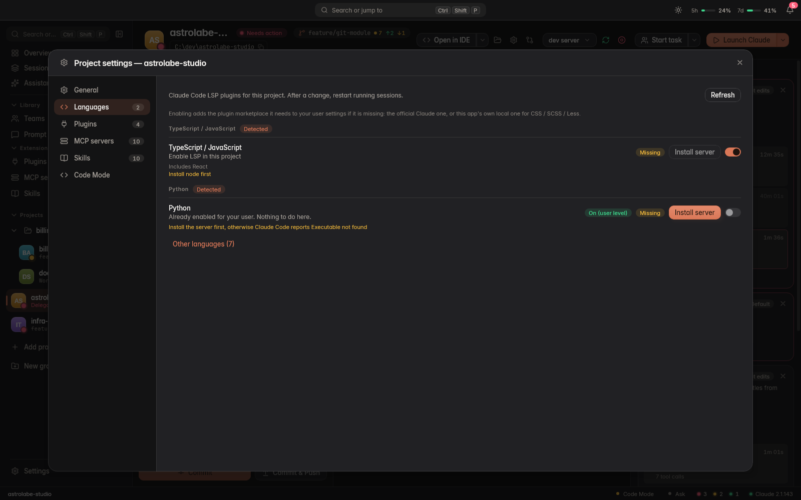<br/>**Мови (LSP)** | 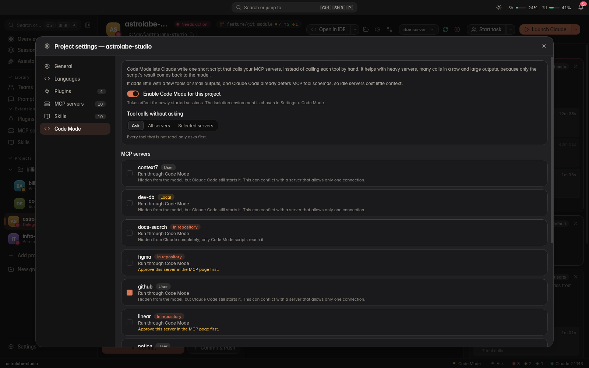<br/>**Code Mode** |

<details>
<summary>Світла тема</summary>

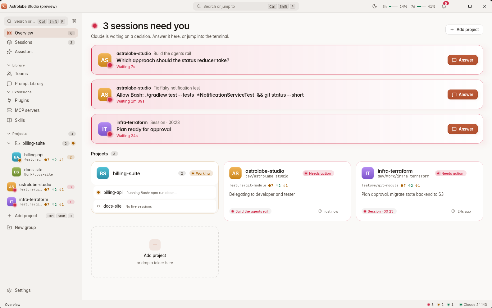

</details>

> Скріншоти зроблено у вбудованому режимі попереднього перегляду на вигаданих даних.

## Вимоги

Щоб користуватися застосунком:

- [Claude Code](https://code.claude.com/docs/en/overview) (нативний `claude`), встановлений і з виконаним входом.
- `git` у `PATH` для вкладки Git.

Щоб зібрати з коду:

- JDK для запуску Gradle (17 або новіший). Збірка сама завантажить **JetBrains Runtime 25** через Foojay resolver
  (близько 670 МБ, один раз). Більше нічого встановлювати не треба.
- Пакування треба виконувати на цільовій ОС: інсталятор для Windows збирається у Windows, `.deb` у Linux, `.dmg` у macOS.

> Найкраще протестовано Windows. Linux-пакети встановлювали на Ubuntu, Fedora і Manjaro; macOS тестувався менше.

## Встановлення

### Windows

Завантажте `.msi` зі сторінки [Releases](https://github.com/krpkbhdn/astrolabe-studio/releases), звірте його з опублікованим
`.sha256` (`(Get-FileHash .\<installer>.msi).Hash`) і запустіть. Установка йде для поточного користувача, з пунктом у меню «Пуск» і ярликом на робочому столі.

> Інсталятор не підписаний, тому Windows SmartScreen може попередити. Після перевірки хешу оберіть *Докладніше*, потім *Усе одно виконати*.

### Перевірка завантаженого файлу

Біля кожного файлу є `<file>.sha256` у форматі `sha256sum` (`sha256sum -c <file>.sha256`) і атестація походження збірки:

```sh
gh attestation verify <file> --repo krpkbhdn/astrolabe-studio
```

Якщо до релізу додано підписи `<file>.asc`, імпортуйте відкритий ключ `packaging/astrolabe-release.pub.asc` із цього репозиторію (`gpg --import packaging/astrolabe-release.pub.asc`) і перевірте командою `gpg --verify <file>.asc <file>`.

### Linux

Завантажте пакет для свого дистрибутива зі сторінки [Releases](https://github.com/krpkbhdn/astrolabe-studio/releases) (x64):

```sh
sudo apt install ./astrolabe-studio-<версія>-linux-x64.deb     # Debian, Ubuntu
sudo dnf install ./astrolabe-studio-<версія>-linux-x64.rpm     # Fedora, RHEL, openSUSE (zypper install)
tar xzf astrolabe-studio-<версія>-linux-x64.tar.gz && ./install.sh   # будь-який дистрибутив, напр. Arch, Manjaro; для користувача, без root
```

Інсталятор `.tar.gz` описано в розділі [Збірка інсталяторів](#збірка-інсталяторів).

### macOS

Завантажте `.dmg` зі сторінки [Releases](https://github.com/krpkbhdn/astrolabe-studio/releases), відкрийте його й перетягніть застосунок до «Програм». Він не підписаний і не нотаризований, тому під час першого запуску скористайтеся правим кліком і *Відкрити*.

### Оновлення

У Windows, macOS і Linux застосунок перевіряє останній реліз на GitHub і пропонує його встановити. Кожне оновлення мусить мати чинний GPG-підпис (`<file>.asc`) закріпленого ключа релізів і відповідну суму SHA-256, інакше його не встановлять. Установка з `.tar.gz` оновлюється для користувача; `.deb` і `.rpm` просять пароль через `pkexec` (polkit). Для Linux arm64 сповіщень про оновлення немає (збирається лише x64).

## Збірка і запуск із коду

```sh
git clone https://github.com/krpkbhdn/astrolabe-studio.git
cd astrolabe-studio
```

| Завдання | Windows (PowerShell) | Linux / macOS / Git Bash |
|---|---|---|
| Запустити застосунок | `.\gradlew run` | `./gradlew run` |
| Тести | `.\gradlew test` | `./gradlew test` |
| Компіляція, тести, jar | `.\gradlew build` | `./gradlew build` |
| Інсталятор | `.\gradlew packageMsi` (або `packageExe`) | `./gradlew packageDeb` (Linux), `./gradlew packageDmg` (macOS) |

Інсталятори з'являються в `build/compose/binaries/main/<формат>/`.

Перша збірка потребує інтернету: вона завантажує Gradle і JBR 25, тож триває довго. Без JBR застосунок повертається до звичайної рамки вікна ОС; `-Dastrolabe.nativeFrame=true` примусово вмикає нативну рамку ОС, навіть на JBR.

## Збірка інсталяторів

| Платформа | Формати | Задача |
|---|---|---|
| Windows x64 | `.msi`, `.exe` | `packageMsi`, `packageExe` |
| Linux x64 | `.deb` (Debian/Ubuntu), `.rpm` (Fedora/RHEL/openSUSE), тека AppImage (app image від jpackage), портативний `.tar.gz` (також для Arch/Manjaro) | `packageDeb`, `packageRpm`, `packageAppImage`, `packageTarGz` |
| macOS arm64 | `.dmg`, `.pkg` | `packageDmg`, `packagePkg` |

`./gradlew packageDistributionForCurrentOS` збирає всі формати поточної ОС. Результати лежать у `build/compose/binaries/main/<формат>/` (`.tar.gz` у `tar/`). Локальні збірки не підписані; релізи, зібрані в CI, мають GPG-підписи `.asc` і підтвердження походження збірки (див. [Перевірка завантаженого файлу](#перевірка-завантаженого-файлу)); самі інсталятори Windows і macOS не підписані кодом.

- Linux `.tar.gz`: `tar xzf astrolabe-studio-<версія>-linux-x64.tar.gz`, перейдіть у теку й запустіть `./install.sh`, щоб додати Astrolabe Studio до меню застосунків (`sudo ./install.sh` або `--system` для всіх користувачів). Скрипт копіює застосунок у `~/.local/opt/astrolabe-studio`, робить посилання `~/.local/bin/astrolabe-studio` і кладе іконку та `astrolabe-studio.desktop` у `~/.local/share` (системний режим: `/opt`, `/usr/local/bin`, `/usr/share`); повторний запуск оновлює. `./uninstall.sh` прибирає саме це; ваші дані в `~/.astrolabe-studio` лишаються.
- jpackage не вміє кросукомпіляцію: збирайте на цільовій ОС і архітектурі. Linux arm64 і Windows arm64 не тестувалися.
- Потрібно: JDK для запуску Gradle; тулчейн JBR 25 (JCEF) збірка завантажує сама (близько 670 МБ, один раз). Windows `.msi`/`.exe`: WiX Toolset у `PATH` (3.x; новіші версії не перевірено). Linux: `rpmbuild` (для `.rpm`) і `fakeroot` (для `.deb`). macOS: інструменти командного рядка Xcode.
- Linux: `.deb` вказує бібліотеки, потрібні JCEF (вкладка Web), як `Recommends`, а `.rpm` і `.tar.gz` їх не оголошують, тож на чистій системі можуть знадобитися `libnss3`, `libgbm`, `libatk` тощо.

## Гарячі клавіші

<details>
<summary>Показати всі комбінації</summary>

Таблиця показує комбінації для Windows і Linux. У macOS більшість із них використовують натомість `Cmd` або `Cmd+Shift` (`Cmd+T`, `Cmd+O`, `Cmd+K`, `Cmd+1`..`9`, `Cmd+Shift+S/I/E/N/G/K/U/R/Y/Z/M`); `Alt+F12` не змінюється.

| Дія | Комбінація |
|---|---|
| Палітра команд | `Ctrl+Shift+P` |
| Довідник клавіш | `F1` або `Ctrl+Shift+/` |
| Додати проєкт | `Ctrl+Shift+O` |
| Нова сесія Claude | `Ctrl+Shift+T` |
| Усі сесії | `Ctrl+Shift+S` |
| Відповісти наступній сесії, що чекає | `Ctrl+Shift+N` |
| Асистент / запитати асистента | `Ctrl+Shift+I` / `Ctrl+Shift+E` |
| Git / коміт / push | `Ctrl+Shift+G` / `Ctrl+Shift+K` / `Ctrl+Shift+U` |
| Запустити вибрану конфігурацію | `Ctrl+Shift+R` |
| Рев'ю | `Ctrl+Shift+Z` |
| Використання | `Ctrl+Shift+Y` |
| Сповіщення | `Ctrl+Shift+M` |
| Відкрити термінал | `Alt+F12` |
| Проєкт 1-9 / Огляд | `Alt+1`..`Alt+9` / `Alt+0` |

Звичайні `Ctrl+літера` йдуть у термінал, тому застосунок використовує `Ctrl+Shift`.

</details>

## Конфігурація

Дані зберігаються в `~/.astrolabe-studio` (база SQLite `astrolabe-studio.db`); розташування змінює властивість `astrolabe.data-dir` (або змінна середовища `ASTROLABE_DATA_DIR`).
`./gradlew run` з git worktree використовує натомість `<tmp>/astrolabe-studio-worktrees/<тека worktree>`, якщо не задано `ASTROLABE_DATA_DIR`.
Налаштування це властивості `astrolabe.*`, див. [`application.properties`](src/main/resources/application.properties).
Довідник про хуки та протокол: [docs/claude-code-protocol.md](docs/claude-code-protocol.md).

## Ліцензія

Ліцензовано за Apache License, Version 2.0 — див. [LICENSE](LICENSE).

Copyright 2026 Bohdan Krupko

## Підтримати проєкт

Astrolabe Studio безкоштовний і створюється у вільний час. Якщо він заощаджує вам час і ви хочете підтримати проєкт та його автора, можете пригостити мене кавою. Дякую!

[](https://ko-fi.com/krpkbhdn)
